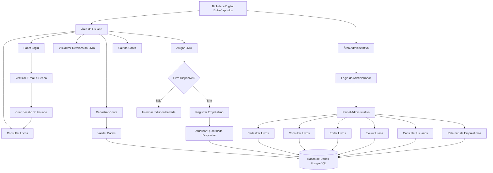
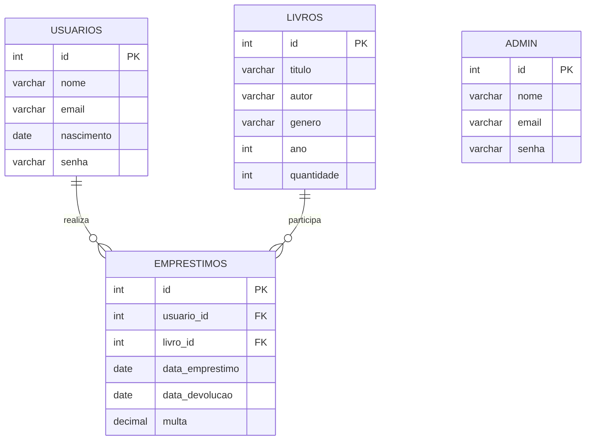

# 📚 EntreCapítulos — Biblioteca Digital

Sistema de biblioteca digital desenvolvido em PHP, HTML, CSS e PostgreSQL, como parte do Projeto Integrador.

O EntreCapítulos permite que os usuários criem uma conta, façam login, consultem livros e realizem empréstimos. O administrador pode cadastrar, consultar, editar e excluir livros, além de visualizar os usuários e os relatórios de empréstimos.

## Sumário

- Sobre o projeto
- Tecnologias utilizadas
- Requisitos funcionais
- Regras de negócio
- Requisitos não funcionais
- Fluxo de trabalho
- Banco de dados
- Organização do código
- Como executar o projeto

## 1. Sobre o projeto

O **EntreCapítulos** é uma biblioteca digital criada para facilitar a consulta e o empréstimo de livros. O sistema possui uma interface para os usuários e uma área administrativa para o gerenciamento das informações.

O sistema trabalha com dois tipos de acesso:

| Tipo de usuário | O que pode fazer |
|---|---|
| Visitante | Acessar a página inicial, criar uma conta e fazer login. |
| Usuário | Consultar livros, visualizar informações e realizar empréstimos. |
| Administrador | Cadastrar, consultar, editar e excluir livros, consultar usuários e visualizar relatórios de empréstimos. |

### Principais funcionalidades

- Cadastro de usuários com nome, e-mail, nascimento e senha.
- Login e controle de sessão.
- Consulta e listagem de livros disponíveis.
- Pesquisa e visualização das informações dos livros.
- Empréstimo de livros com atualização da quantidade disponível.
- Área administrativa com operações CRUD.
- Relatório de empréstimos com informações dos usuários e dos livros.
- Encerramento da sessão do usuário e do administrador.

## 2. Tecnologias utilizadas

| Camada | Tecnologia | Utilização |
|---|---|---|
| Front-end | HTML | Estrutura das páginas e formulários. |
| Estilização | CSS | Aparência, cores, botões e organização das páginas. |
| Back-end | PHP | Processamento dos formulários, login, sessões e regras do sistema. |
| Banco de dados | PostgreSQL | Armazenamento dos usuários, livros, administradores e empréstimos. |
| Conexão com o banco | PDO | Comunicação entre o PHP e o PostgreSQL. |
| Controle de versão | Git e GitHub | Armazenamento e acompanhamento das alterações do projeto. |

## 3. Requisitos funcionais

| Código | Requisito | Quem utiliza |
|---|---|---|
| RF01 | Cadastrar usuários com nome, e-mail, nascimento e senha. | Visitante |
| RF02 | Validar os dados informados no cadastro. | Sistema |
| RF03 | Realizar login com e-mail e senha. | Usuário e administrador |
| RF04 | Criar uma sessão após o login bem-sucedido. | Sistema |
| RF05 | Listar os livros cadastrados. | Usuário e administrador |
| RF06 | Exibir título, autor, gênero, ano e quantidade disponível. | Usuário e administrador |
| RF07 | Consultar as informações de um livro. | Usuário e administrador |
| RF08 | Realizar o empréstimo de livros disponíveis. | Usuário |
| RF09 | Atualizar a quantidade disponível após o empréstimo. | Sistema |
| RF10 | Cadastrar novos livros. | Administrador |
| RF11 | Consultar os livros cadastrados. | Administrador |
| RF12 | Editar as informações dos livros. | Administrador |
| RF13 | Excluir livros cadastrados. | Administrador |
| RF14 | Consultar os usuários cadastrados. | Administrador |
| RF15 | Visualizar o relatório de empréstimos. | Administrador |
| RF16 | Encerrar a sessão e redirecionar para a página inicial. | Usuário e administrador |

## 4. Regras de negócio

| Código | Regra |
|---|---|
| RN01 | O cadastro deve receber os dados necessários do usuário e validar as informações. |
| RN02 | O login deve conferir as credenciais com os dados armazenados no banco de dados. |
| RN03 | O acesso às páginas restritas depende da sessão e do tipo de usuário. |
| RN04 | O administrador é responsável pelo gerenciamento dos livros cadastrados. |
| RN05 | O empréstimo só deve ser realizado quando houver exemplares disponíveis. |
| RN06 | Após um empréstimo bem-sucedido, a quantidade disponível deve ser atualizada. |
| RN07 | Um livro com quantidade igual a zero deve ser apresentado como indisponível. |
| RN08 | O relatório deve relacionar os usuários aos livros emprestados e às respectivas datas. |
| RN09 | O encerramento da sessão deve impedir a continuidade do acesso autenticado. |
| RN10 | As alterações realizadas pelo sistema devem ser registradas no banco de dados. |

## 5. Requisitos não funcionais

| Código | Categoria | Requisito |
|---|---|---|
| RNF01 | Usabilidade | As páginas devem ser organizadas e fáceis de utilizar. |
| RNF02 | Compatibilidade | O sistema deve funcionar em um navegador compatível com HTML e CSS atuais. |
| RNF03 | Persistência | Os dados cadastrados devem ser armazenados no PostgreSQL. |
| RNF04 | Manutenção | O código deve estar organizado em arquivos de acordo com suas funções. |
| RNF05 | Segurança | As páginas administrativas devem verificar a autenticação e a permissão de acesso. |
| RNF06 | Integridade | As operações de empréstimo devem evitar a redução indevida da quantidade de livros. |
| RNF07 | Confiabilidade | O sistema deve apresentar mensagens adequadas quando ocorrerem erros ou operações bem-sucedidas. |

## 6. Fluxo de trabalho

### 6.1. Fluxo do usuário

```text
Página inicial
      │
      ▼
Criar conta ou fazer login
      │
      ▼
Validar os dados
      │
      ├── Dados incorretos
      │        │
      │        ▼
      │   Exibir mensagem de erro
      │
      └── Dados corretos
               │
               ▼
        Criar sessão do usuário
               │
               ▼
         Consultar livros
               │
               ▼
       Visualizar informações
               │
               ▼
        Deseja alugar o livro?
               │
          ┌────┴────┐
          ▼         ▼
         Não       Sim
          │         │
          │         ▼
          │   Verificar quantidade
          │         │
          │    ┌────┴────┐
          │    ▼         ▼
          │ Disponível?  Não
          │    │         │
          │   Sim        ▼
          │    │    Informar que o
          │    │    livro está indisponível
          │    ▼
          │ Registrar empréstimo
          │    │
          │    ▼
          │ Atualizar quantidade
          │    │
          └────┴────► Voltar à consulta
                         │
                         ▼
                    Sair da conta
```

### 6.2. Fluxo do administrador

```text
Página inicial
      │
      ▼
Login do administrador
      │
      ▼
Validar credenciais
      │
      ▼
Painel administrativo
      │
      ├── Cadastrar livros
      │
      ├── Consultar livros
      │
      ├── Editar livros
      │
      ├── Excluir livros
      │
      ├── Consultar usuários
      │
      └── Consultar relatório de empréstimos
                    │
                    ▼
              Banco de dados
                    │
                    ▼
             Sair da conta
```

### 6.3. Diagrama geral do sistema



## 7. Banco de dados

O sistema utiliza o PostgreSQL para armazenar as informações necessárias para o funcionamento da biblioteca.

### Tabelas principais

| Tabela | Finalidade |
|---|---|
| `usuarios` | Armazena os dados das pessoas cadastradas. |
| `admin` | Armazena os dados utilizados no acesso administrativo. |
| `livros` | Armazena os livros, seus autores, gêneros, anos e quantidades. |
| `emprestimos` | Registra os empréstimos, relacionando usuários e livros, além das datas e da multa prevista no modelo. |

### Relacionamento entre as tabelas



A tabela `emprestimos` conecta cada registro de empréstimo a um usuário e a um livro. A tabela `admin` representa o acesso administrativo separado, conforme a estrutura utilizada no projeto.

## 8. Organização do código

O projeto é organizado em diretórios para separar as páginas, a conexão com o banco de dados, as funções e os estilos.

```text
projeto_integrador/
│
├── index.php
│
├── database/
│   └── connect.php
│
├── includes/
│   └── functions.php
│
├── login/
│   ├── login.php
│   ├── cadastrar.php
│   └── verefica_user.php
│
├── client/
│   └── livros.php
│
├── admin/
│   ├── painel.php
│   ├── cadastrar_livro.php
│   ├── editar_livro.php
│   ├── excluir_livro.php
│   └── relatorio.php
│
└── style/
    └── style.css
```

*Observação: a estrutura acima representa os principais arquivos conhecidos do projeto. Mantenha no README apenas os nomes que correspondem aos arquivos existentes na sua versão.*

### Função de cada diretório

- **`index.php`:** página inicial do sistema.
- **`database/`:** conexão com o banco de dados PostgreSQL.
- **`includes/`:** funções utilizadas em diferentes páginas.
- **`login/`:** cadastro, autenticação e verificação da sessão.
- **`client/`:** páginas destinadas ao usuário comum.
- **`admin/`:** gerenciamento dos livros e consulta de informações administrativas.
- **`style/`:** arquivos CSS responsáveis pela aparência do site.

## 9. Como executar o projeto

### Requisitos

- PHP instalado e configurado com suporte ao PostgreSQL.
- PostgreSQL instalado e em execução.
- Servidor web ou servidor de desenvolvimento do PHP.
- Git, caso queira clonar o projeto do GitHub.

### Passo 1 — Baixar o projeto

Clone o repositório e entre na pasta do projeto:

```bash
git clone https://github.com/Julia-Batagin/projeto_integrador.git
cd projeto_integrador
```

### Passo 2 — Criar o banco de dados

No PostgreSQL, crie um banco de dados chamado `biblioteca` ou utilize o nome configurado no arquivo de conexão.

Exemplo:

```sql
CREATE DATABASE biblioteca;
```

Depois, crie as tabelas necessárias de acordo com a estrutura SQL do projeto.

### Passo 3 — Configurar a conexão

Abra o arquivo `database/connect.php` e confira as configurações de conexão com o PostgreSQL.

Exemplo de configuração:

```php
<?php

$host = "localhost";
$dbname = "biblioteca";
$port = "5432";
$user = "SEU_USUARIO";
$pass = "SUA_SENHA";

try {
    $conexao = new PDO(
        "pgsql:host=$host;port=$port;dbname=$dbname",
        $user,
        $pass
    );
} catch (PDOException $e) {
    die("Não foi possível conectar ao banco de dados.");
}
```

Substitua `SEU_USUARIO` e `SUA_SENHA` pelas credenciais do seu ambiente. Não publique senhas reais no GitHub.

### Passo 4 — Iniciar o servidor

No terminal, dentro da pasta do projeto, execute:

```bash
php -S localhost:8000
```

Deixe o terminal aberto enquanto utiliza o sistema.

### Passo 5 — Acessar no navegador

Abra o endereço:

```text
http://localhost:8000
```

O banco de dados precisa estar em execução e a conexão deve estar configurada corretamente para que as funções que dependem do PostgreSQL funcionem.

## 10. Projeto Integrador

O EntreCapítulos foi desenvolvido para aplicar os conhecimentos de desenvolvimento web, programação em PHP, estruturação de páginas com HTML e CSS e armazenamento de dados com PostgreSQL.

O projeto também trabalha com operações CRUD — *Create, Read, Update e Delete* —, autenticação de usuários, controle de acesso e relacionamento entre tabelas de um banco de dados.
