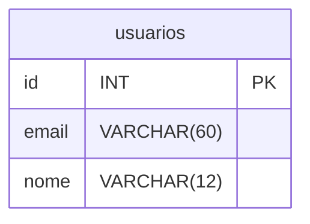

# Mini Sistema: Gerenciamento de Alunos.

## CRUD Utilizando HTML + PHP + POSTGRESQL

### Objetivos:
 
1. Cadastrar Aluno:
- Receber Nome, Turma, Nascimento, Ativo.

2. Excluir Aluno:
- Excluir um aluno a partir do ID.

3. Relátorio:
- Listar todos os alunos cadastrados no sistema.

4. Consultar Aluno:
- Consulta de um aluno específico a partir do ID.

5. Atualizar Aluno:
- Atualizar aluno a partir do ID.

### Sistema de login.
RF Descrição
1. Tabela usuários 

2. Cadastro de usuários

3. Criar login

4. Verificar se os usuários são validos em todas as paginas